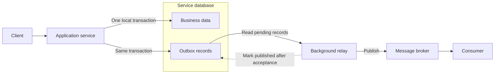
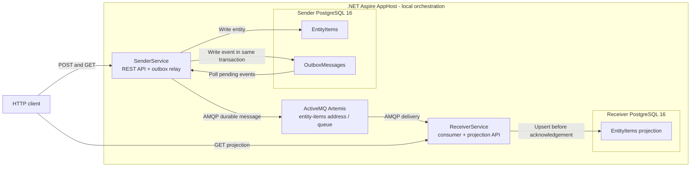
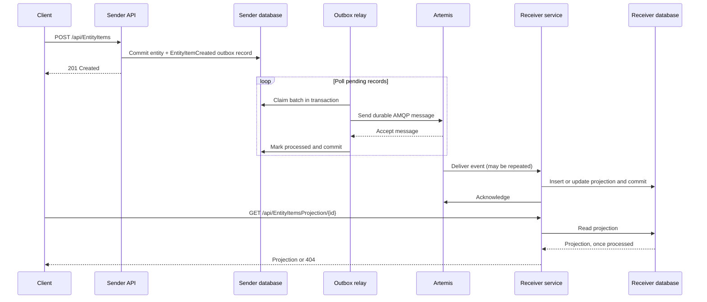

# Transactional Outbox with .NET Aspire

[](https://opensource.org/licenses/MIT)
[](https://github.com/engineering87/dotnet-aspire-outbox-demo/issues)
[](https://dotnet.microsoft.com/languages/csharp)
[](https://github.com/engineering87/dotnet-aspire-outbox-demo)

A reference application demonstrating reliable event publication with the **Transactional Outbox Pattern**, built with .NET 11, .NET Aspire, PostgreSQL, and ActiveMQ Artemis.

## Contents

- [Overview](#overview)
- [The transactional outbox pattern](#the-transactional-outbox-pattern)
- [Architecture of this sample](#architecture-of-this-sample)
- [Event flow](#event-flow)
- [Getting started](#getting-started)
- [API](#api)
- [Reliability and limitations](#reliability-and-limitations)
- [Technology stack](#technology-stack)
- [License](#license)

## Overview

The sample contains two independently persisted services. `SenderService` accepts an HTTP request, saves a domain entity and its outbox record in one database transaction, and publishes the event asynchronously. `ReceiverService` consumes the event from Artemis and stores a read-side projection in its own PostgreSQL database.

The repository is intended for learning and experimentation. It illustrates the core pattern, but is **not a production-ready template**. Review the [limitations](#reliability-and-limitations) before adapting it for another environment.

## The transactional outbox pattern

Writing to a database and publishing to a broker are two separate operations. If a service writes the database and crashes before publishing, the event is lost; if it publishes first and the database transaction fails, consumers can observe an event for a change that never happened. The outbox avoids this **dual-write problem** without a distributed transaction.



The local transaction commits both the business change and the event record, or neither. A separate relay publishes committed records and records its progress. This is asynchronous: the database commit does not mean that consumers have already processed the event. If the relay crashes after broker acceptance but before recording success, it can publish again. Consumers must therefore tolerate duplicates; the pattern alone does not provide exactly-once delivery.

## Architecture of this sample



| Component | Responsibility | Storage / connection |
| --- | --- | --- |
| `SenderService` | HTTP API, domain writes, and background outbox relay | Sender PostgreSQL database; Artemis over AMQP |
| `ReceiverService` | Artemis consumer and projection API | Separate receiver PostgreSQL database; Artemis over AMQP |
| Aspire AppHost | Local orchestration, connection references, and resource lifecycle | Artemis container and two PostgreSQL resources |
| `ServiceDefaults` | Shared health endpoint and development Swagger setup | Referenced by both services |

The AppHost waits for the dependencies and supplies the database and Artemis connection information. PostgreSQL data and the Artemis journal use named volumes. The AppHost is an orchestrator, not a hop in the message flow. A container runtime must be available locally.

## Event flow



The broker can deliver before the relay commits its processed status; the sequence above shows the acknowledgement boundaries, not a global ordering guarantee. A `201 Created` response only confirms the sender's local transaction: the projection can temporarily return `404` until the event is consumed.

## Getting started

### Prerequisites

- .NET 11 SDK
- Docker-compatible container runtime (for example, Docker Desktop or Podman)

### Run the application

From the repository root, start the Aspire AppHost:

```powershell
dotnet run --project src\dotnet-aspire-outbox-demo\dotnet-aspire-outbox-demo\Aspire.AppHost.csproj
```

Aspire starts the services, PostgreSQL instances, and Artemis broker. Open the Aspire dashboard URL printed by the AppHost to find service URLs and inspect resource status and logs. Swagger is available at `/swagger` in Development.

### Try the flow

Replace the URLs with the sender and receiver endpoints shown in the Aspire dashboard:

```powershell
$sender = 'https://localhost:<sender-port>'
$receiver = 'https://localhost:<receiver-port>'
$body = @{ name = 'Example'; value = 42 } | ConvertTo-Json
$item = Invoke-RestMethod -Method Post -Uri "$sender/api/EntityItems" -ContentType 'application/json' -Body $body
Invoke-RestMethod -Uri "$sender/api/EntityItems/$($item.id)"
Invoke-RestMethod -Uri "$receiver/api/EntityItemsProjection/$($item.id)"
```

Use the actual HTTP or HTTPS endpoints shown in the dashboard. The receiver request may initially return `404`; retry after the relay and consumer have processed the event.

### Run the tests

```powershell
dotnet test src\dotnet-aspire-outbox-demo\OutboxDemo.Tests\OutboxDemo.Tests.csproj
```

The repository’s `global.json` configures the Microsoft.Testing.Platform runner used by xUnit v3. Tests using EF Core's in-memory provider do not verify PostgreSQL locking or actual broker delivery; validate those paths with the real services as well.

## API

The services expose these endpoints:

| Service | Method | Endpoint | Description |
| --- | --- | --- | --- |
| Sender | `POST` | `/api/EntityItems` | Creates an entity and its outbox record |
| Sender | `GET` | `/api/EntityItems` | Lists sender entities |
| Sender | `GET` | `/api/EntityItems/{id}` | Gets a sender entity by ID |
| Receiver | `GET` | `/api/EntityItemsProjection` | Lists received projections |
| Receiver | `GET` | `/api/EntityItemsProjection/{id}` | Gets a projection by ID |

Swagger is enabled in the Development environment. Check the Aspire dashboard for the service URLs assigned at runtime.

## Reliability and limitations

The design targets **at-least-once** delivery for successfully processed messages, not exactly once. Delivery depends on the broker's configuration and retained data, and messages rejected or exhausted by its delivery policy require operational intervention.

- **Atomic local write:** the entity and its outbox record commit together. There is no distributed transaction with Artemis or the receiver database.
- **Asynchronous delivery:** the relay polls every five seconds and claims up to 50 eligible records. It immediately continues after publishing a full batch.
- **Multiple sender instances:** PostgreSQL `FOR UPDATE SKIP LOCKED` prevents concurrent claims of the same rows while the transaction holds the locks. Global ordering across instances is not guaranteed. The relay holds these database locks while sending to the broker.
- **Retries:** each publish attempt has a 10-second timeout. On failure, the record stays pending, the batch stops, and the record becomes eligible again after 30 seconds. Monitor `RetryCount`, `LastError`, `FailedAt`, and pending record age. Processed records are not automatically purged.
- **Duplicate handling:** the outbox ID is sent as Artemis duplicate detection ID (`_AMQ_DUPL_ID`). Broker-side deduplication depends on its bounded cache and configuration; it is not a substitute for consumer idempotency. The receiver upserts this event's projection by entity ID, but does not implement a general-purpose inbox or event ordering.
- **Receiver failures:** unknown types and invalid payloads are rejected; other processing failures are returned for redelivery. Dead-letter routing, retry limits, and the availability of a dead-letter queue depend on Artemis address settings. The AppHost does not configure these policies explicitly: verify them for the broker image in use and arrange monitoring and replay.
- **Broker durability:** messages are marked durable and the journal uses the `artemisdata` volume. Preserve that volume and configure durable queues and broker policies for the required guarantees. The sample uses the Artemis image's `latest` tag, so its defaults can change.
- **Database initialization:** both services use `EnsureCreated()` without deleting existing data. It does not update an existing schema; introduce EF Core migrations and plan the transition for existing databases before evolving the model.
- **Local configuration and observability:** the AppHost uses demo broker credentials and fixed local broker ports. Replace credentials and configure secure connections before deployment. `/health` is a basic health endpoint, not a dependency readiness check; the shared defaults do not configure distributed telemetry export.

## Technology stack

- .NET 11 and ASP.NET Core
- .NET Aspire 13
- Entity Framework Core and PostgreSQL
- ActiveMQ Artemis using AMQP
- xUnit v3 and Microsoft.Testing.Platform

## Purpose

Use this repository as a learning reference or a starting point for exploring message-driven services. Before using the sample as a production foundation, address the operational limitations described above, particularly schema migrations, dead-letter handling, and monitoring of pending outbox records.

## License

This project is distributed under the MIT License. See [LICENSE](LICENSE) for details.
